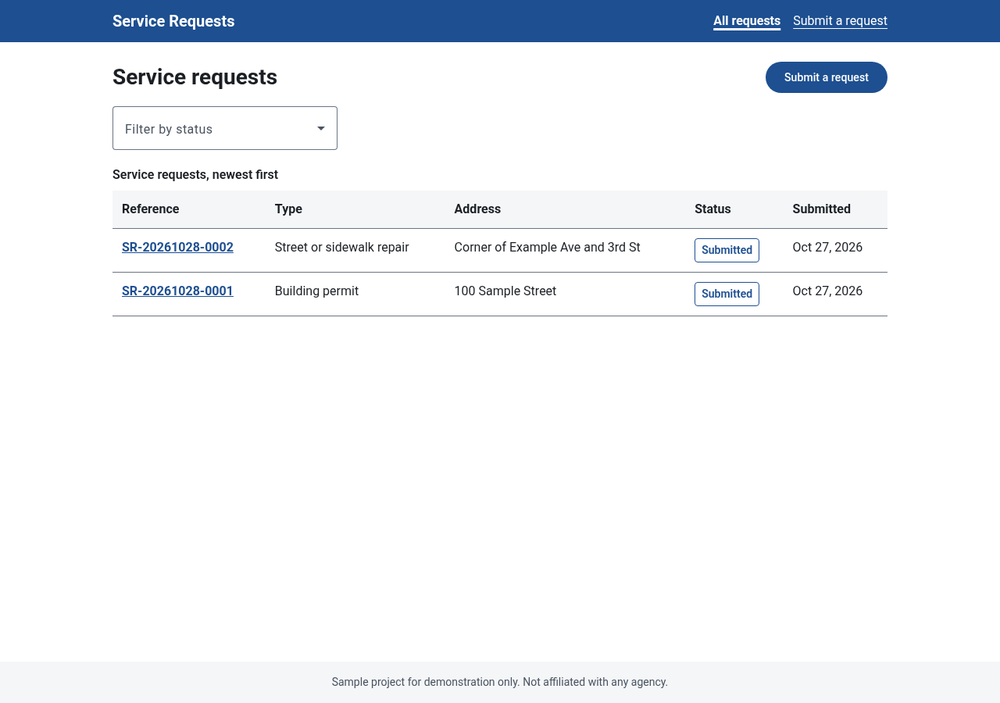
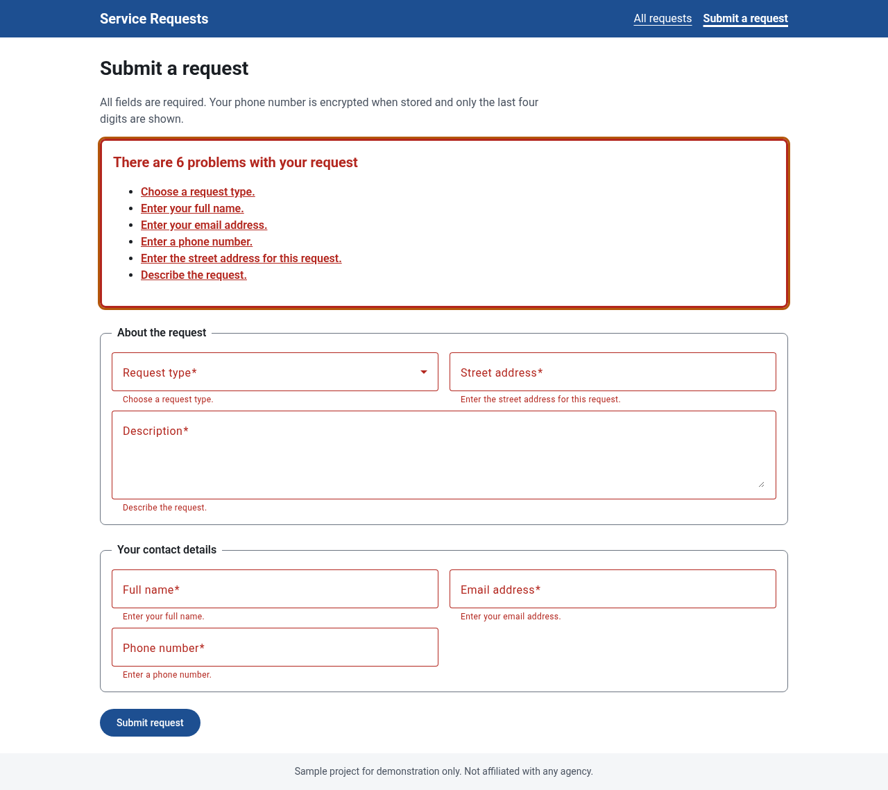
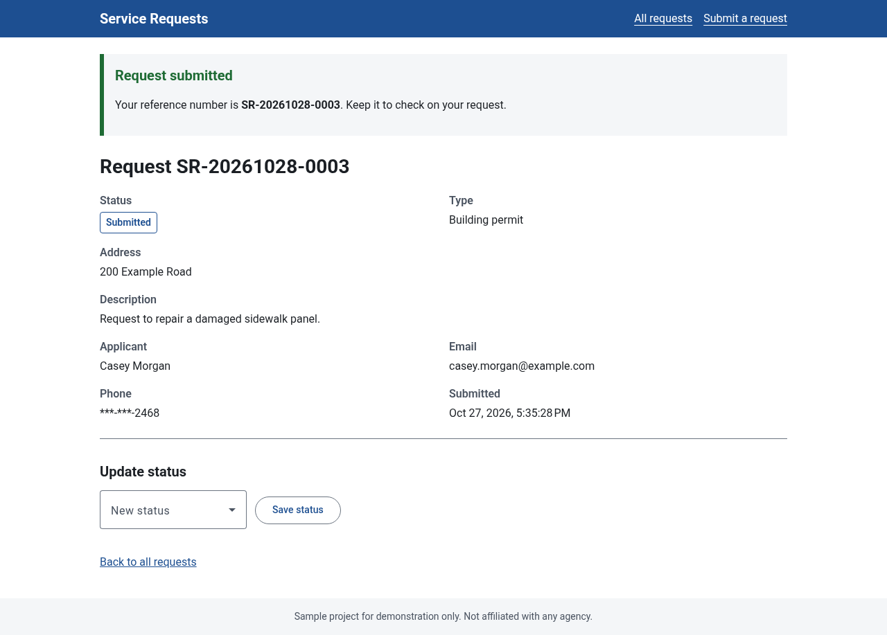
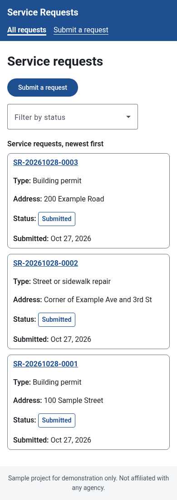

# Accessible Permit Portal

A small **personal sample project** showing a full stack .NET + Angular application built with accessibility as a core requirement.
It is a generic "service request / permit tracker" of the kind a public-sector website might offer: residents submit a request, see a list of requests, and staff move a request through review.

> This is a demonstration project written by Mohanraj Periasamy. It is not client work, and it is not affiliated with any government agency. All names and addresses in the sample data are fictional.



## What it shows

| Area | What is in this repo |
|---|---|
| Back end | ASP.NET Core 8 Web API (C#) with controllers, a **service layer** for business rules, and **EF Core** data access |
| Data | SQLite by default so it runs with no setup; switch to **SQL Server** with one setting |
| Validation | Data annotations on request DTOs (returned as standard `ValidationProblemDetails`), plus business rules in the service layer (allowed status transitions) |
| Sensitive data | The applicant's phone number is encrypted at rest with the **ASP.NET Core Data Protection API**; the API only returns a masked value |
| Front end | **Angular 21** (standalone components, signals, reactive forms) with **Angular Material** |
| Design system | **Sass/SCSS design tokens** (color, spacing, type, shape) exposed as CSS custom properties, used by both the custom components and the Material theme |
| Accessibility | Built to **WCAG 2.1 AA**: skip link, landmarks, labels, keyboard support, focus management, live regions, error summary, contrast-checked palette, responsive layout |
| Tests | xUnit tests for the service layer and validation; Angular component tests that include **axe-core** checks; a headless-Chrome axe scan of the running app |
| CI/CD | `azure-pipelines.yml` that builds, tests and publishes both apps and runs the accessibility scan |

## Run it locally

Requirements: .NET 8 SDK, Node.js 20.19 or later, and (for the browser accessibility scan) Google Chrome.

```bash
# 1. API (http://localhost:5080, Swagger at /swagger)
cd src/PermitPortal.Api
dotnet run

# 2. Angular client (http://localhost:4200, proxies /api to the API)
cd client
npm install
npm start
```

To run both from one URL the way it would be deployed, build the client into the API's `wwwroot`:

```bash
cd client && npm run build
cp -r dist/client/browser/* ../src/PermitPortal.Api/wwwroot/
cd ../src/PermitPortal.Api && dotnet run   # open http://localhost:5080
```

### Using SQL Server instead of SQLite

Set two values (in `appsettings.json`, user secrets or environment variables):

```bash
Database__Provider=SqlServer
ConnectionStrings__SqlServer="Server=...;Database=PermitPortal;..."
```

The sample creates the schema with `EnsureCreated()` on startup. A production app would use EF Core migrations.

## Tests

```bash
# Back-end unit tests (service layer and validation)
dotnet test

# Front-end component tests, including axe-core checks (Vitest + jsdom)
cd client && npm test

# Browser accessibility scan + keyboard checks against the running app (needs the API running with the client in wwwroot)
cd client && BASE_URL=http://localhost:5080 CHROME_PATH=/usr/bin/google-chrome npm run a11y

# Same scan, also saving screenshots to docs/screenshots
cd client && BASE_URL=http://localhost:5080 npm run screenshots
```

## Architecture

```
src/PermitPortal.Api/
  Controllers/ServiceRequestsController.cs   Thin HTTP layer: routing, status codes, ProblemDetails
  Services/ServiceRequestService.cs          Business rules: reference numbers, status transitions, masking
  Services/SensitiveDataProtector.cs         Wraps IDataProtector (purpose "PermitPortal.ApplicantPhone.v1")
  Data/AppDbContext.cs                       EF Core model (indexes, lengths, enums stored as strings)
  Contracts/Dtos.cs                          Request/response DTOs with validation attributes
tests/PermitPortal.Api.Tests/                xUnit tests (EF Core InMemory + ephemeral Data Protection keys)
client/src/
  styles/_tokens.scss                        Design tokens and mixins
  styles.scss                                Material theme mapped to the tokens, global focus style
  app/app.*                                  Shell: skip link, header/nav, main, footer, focus on navigation
  app/core/                                  API client, models, page focus/announcement service
  app/shared/status-badge.ts                 Design-system component (status shown as text, not color only)
  app/pages/                                 List, form and detail pages
  testing/axe.ts                             axe-core helper for component tests
  scripts/a11y-check.mjs                     axe-core + keyboard checks in headless Chrome
```

**API endpoints**

| Method | Route | Notes |
|---|---|---|
| GET | `/api/service-requests?status=InReview` | List, newest first, optional status filter |
| GET | `/api/service-requests/{id}` | 404 ProblemDetails if not found |
| POST | `/api/service-requests` | 400 ValidationProblemDetails on invalid input |
| PATCH | `/api/service-requests/{id}/status` | 409 ProblemDetails if the transition is not allowed |

**Status flow:** Submitted → In review or Rejected; In review → Approved or Rejected; Approved or Rejected → Closed.

**Sensitive data:** the phone number is normalized to digits, encrypted with Data Protection, and stored with only its last four digits kept separately for display. The encrypted value never leaves the server. Locally, keys are written to `src/PermitPortal.Api/keys/` (git-ignored). In production they should be persisted to shared storage and protected, for example Azure Blob Storage with Azure Key Vault.

## Accessibility

### What was done (target: WCAG 2.1 AA)

- **Skip link** as the first focusable element, moving focus to `<main>` (2.4.1).
- **Landmarks and structure:** header, labelled `<nav>`, `<main>`, footer; one `<h1>` per page; `<fieldset>`/`<legend>` groups in the form; a definition list for request details (1.3.1).
- **Page titles** set per route (2.4.2). After each client-side navigation, focus moves to the page `<h1>` and the new title is announced through a live region, so screen-reader users know the view changed.
- **Labels and instructions:** every control has a visible `mat-label`; hints such as the phone format are linked by Material; required fields are marked (3.3.2).
- **Error handling:** on submit, an error summary (`role="alert"`) lists every problem with links that move focus to the field, and each field shows its own message. Server-side validation errors are mapped onto the same fields (3.3.1, 3.3.3).
- **Live regions:** the list announces its result count when filtered; status changes are announced; failures use `role="alert"` (4.1.3).
- **Keyboard:** all functions work with the keyboard; native links and buttons are used; a visible 3px focus ring with good contrast on every element (2.1.1, 2.4.7).
- **Color and contrast:** the token palette was chosen for at least 4.5:1 text contrast (ratios are noted in `_tokens.scss`); status is always shown as text, not by color alone (1.4.1, 1.4.3, 1.4.11).
- **Tables:** caption, column headers and row headers; on small screens rows become labelled cards (1.3.1, 1.4.10).
- **Responsive and reflow:** single-column layout at narrow widths (1.4.10); `prefers-reduced-motion` is respected.
- **Language:** `lang="en"` on the document (3.1.1).

### How it was tested

- **Automated, component level:** axe-core runs inside the Angular component tests for the form (before and after showing errors) and the list. Color contrast is skipped there because jsdom does not render styles.
- **Automated, browser level:** `scripts/a11y-check.mjs` runs axe-core with the WCAG 2.0/2.1 A and AA rule sets in headless Chrome on five screens (list, empty form, form with errors, confirmation, mobile list). It also checks that the skip link is the first Tab stop and that focus moves to the `<h1>` after navigation. The latest local run reported **no violations** on these screens.
- **Manual screen-reader testing (JAWS, NVDA):** see [docs/manual-screen-reader-checklist.md](docs/manual-screen-reader-checklist.md). The checklist has **not** been filled in for this version.

Automated tools find only some accessibility problems, so a clean axe report does not by itself mean the app conforms to WCAG.

### Known limitations

- On narrow screens the table rows are restyled as cards with `display: block`; some browser and screen-reader combinations may then announce them as plain text rather than table cells. Check this in the manual checklist.
- There is no authentication; the status update form stands in for a staff-only screen.

## Screenshots

| | |
|---|---|
|  |  |
| Error summary with links to each field | Confirmation with reference number |



## License

MIT, see [LICENSE](LICENSE).
